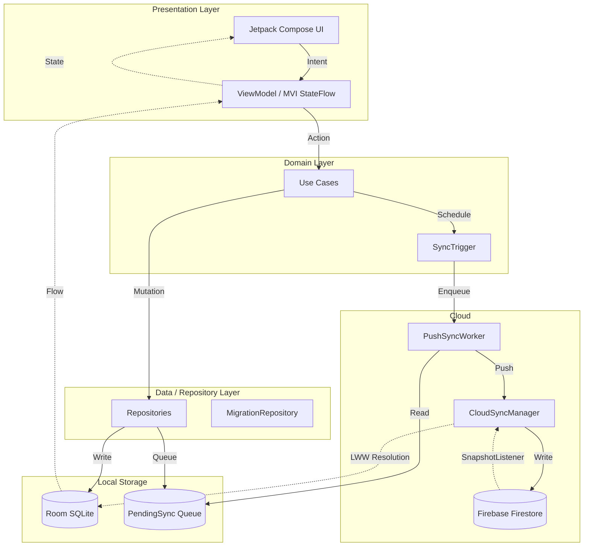
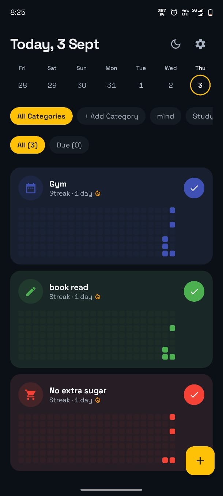
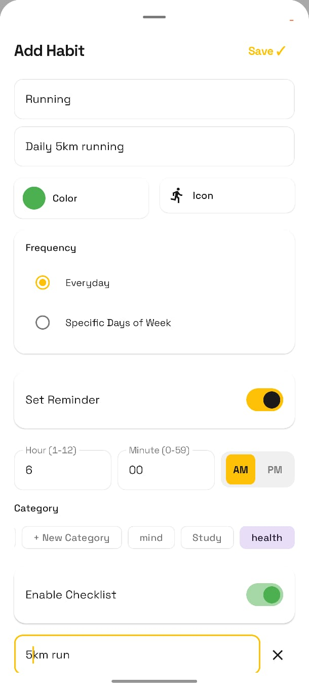
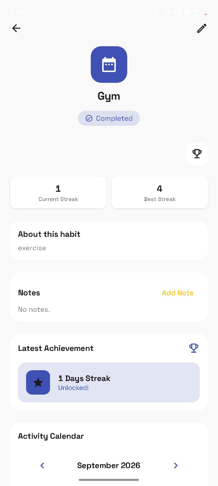
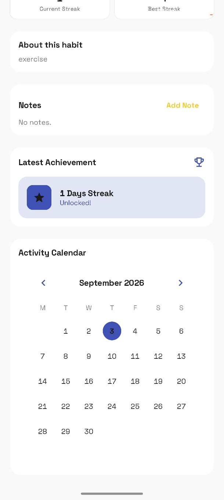
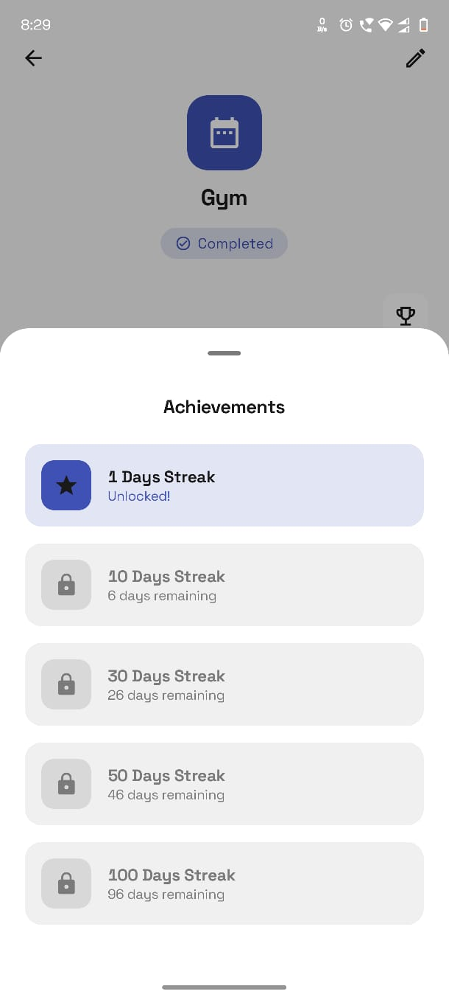
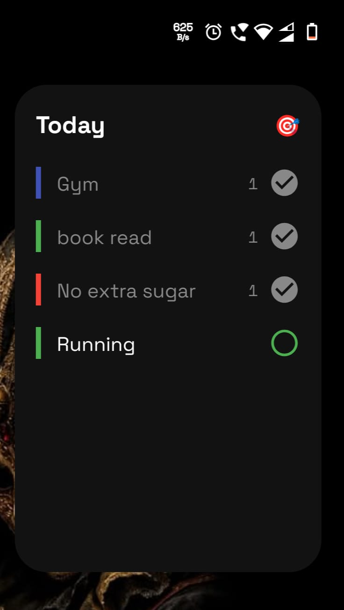

# LoopWell

An offline-first habit management platform built for reliable local usage and cross-device synchronization.

## Overview

LoopWell solves the problem of tracking habits and schedules without relying on a persistent network connection. Built entirely on modern Android architecture principles, the application serves as a robust engineering example of local-first data mutation with eventual consistency. It utilizes Room as the single source of truth for immediate UI responsiveness and synchronizes data via a custom background worker to Firebase Firestore, successfully bridging the gap between instantaneous offline UX and reliable cloud backups.

## Features

### Habit Management
- **Creation & Tracking**: Create habits with customizable schedules and categories.
- **Checklists**: Support for nested checklist items within habits.
- **Streak Computation**: Advanced local streak computation to maintain user engagement.

### Offline-First Architecture
Every interaction (creation, completion, deletion) mutates the local SQLite database first. The UI never waits on network requests, ensuring zero-latency interactions even in airplane mode. 

### Synchronization & Conflict Resolution
- **Background Sync**: Changes are queued in a `PendingSync` table and processed asynchronously via Jetpack WorkManager (`PushSyncWorker`).
- **Last-Write-Wins (LWW) Resolution**: The `CloudSyncManager` applies a timestamp-based conflict resolution strategy, rejecting incoming cloud mutations if a newer local pending mutation exists for the same entity.

### Guest → Cloud Migration
Users can start using the application entirely offline as an anonymous guest. Upon authentication, a dedicated `MigrationRepositoryImpl` safely pushes all local guest data to the authenticated Firestore UID, preventing data loss during the onboarding lifecycle.

### Security
- **Firebase App Check**: Secures the Firestore backend using `PlayIntegrityAppCheckProviderFactory` for release builds (and a configured `DebugAppCheckProviderFactory` for local development), rejecting API calls from untrusted environments or tampered clients.
- **Firestore Security Rules**: Strict UID-based document ownership (`request.auth.uid == userId`) ensures users can only read, write, or mutate their own isolated habit collections.

## Architecture

LoopWell enforces a strict Clean Architecture paradigm separated by functional modules.



1. **Presentation Layer**: 100% Jetpack Compose. `ViewModels` expose immutable `StateFlow` and handle one-time side effects via `Channel` (MVI-inspired). 
2. **Domain Layer**: Contains business logic encapsulated in Use Cases (e.g., `ToggleHabitCompletionUseCase`, `CalculateStreakUseCase`).
3. **Data Layer**: Repositories abstract the data sources.
4. **Local Storage**: Room is the absolute single source of truth.
5. **Synchronization Layer**: WorkManager offloads network I/O, utilizing a custom CloudSyncManager for snapshot listening and LWW reconciliation.

## Offline-First Synchronization

The synchronization engine is designed for absolute reliability:
1. **Local Mutation**: A user marks a habit complete. The `HabitCompletionDao` writes to Room.
2. **Sync Queue**: Concurrently, a `PendingSyncEvent` is written locally with a high-precision timestamp.
3. **Trigger**: `SyncScheduler` enqueues a `OneTimeWorkRequest` for `PushSyncWorker`.
4. **Execution**: The background worker attempts to push all pending queue items to Firestore.
5. **Resolution**: If a concurrent mutation occurs on another device, Firestore broadcasts a Snapshot update. `CloudSyncManager` compares the incoming `updatedAt` timestamp against the newest `PendingSyncEvent` for that entity. If the local pending event is newer, the incoming cloud mutation is safely ignored until the local push succeeds.

## Security

Security is configured at multiple layers:
- **Client Attestation**: Firebase App Check is enforced. Clients without a valid Play Integrity token (or registered debug token) receive a `PERMISSION_DENIED` response before hitting the database.
- **Backend Rules**: Firestore strictly evaluates `match /users/{userId} { allow read, write: if request.auth != null && request.auth.uid == userId; }`. Even with a valid App Check token, cross-tenant data access is mathematically impossible at the database rules layer.

## Testing

The project maintains **21 test suites** covering critical business logic, data mapping, and background processing. 

Key test categories implemented:
- **Domain / Use Cases**: (`CalculateStreakUseCaseTest`, `ToggleHabitCompletionUseCaseTest`, etc.) - Verifies core business rules without Android dependencies.
- **Synchronization**: (`CloudSyncManagerTest`, `PushSyncWorkerTest`) - Validates timestamp-based conflict resolution and Worker success/failure behaviors.
- **Database / DAOs**: Room-based unit tests verifying SQLite constraints, cascade deletions, and data converters.
- **Presentation**: ViewModel tests ensuring proper MVI state emission and side-effect handling.
- **Coroutines**: Utilizes `kotlinx-coroutines-test` and a custom `DispatcherProvider` for predictable `TestDispatcher` execution.

Run the test suite locally:
```bash
./gradlew testDebugUnitTest
```

## Multi-Device Validation

### Device Validation

| Environment | Result |
|-------------|--------|
| Motorola Edge 60 Fusion (Android 16) | Tested - Background Sync, UI, Authentication |
| Android Studio Emulator | Tested - Guest to Cloud Migration |
| Windows PC (Desktop Agent) | Tested - Build & Static Analysis |

## Screenshots

Here is a look at LoopWell's clean, distraction-free interface:








## Demo

[](https://youtube.com/shorts/yEcpdASQORY)

*(Click the image above to watch the full technical demo on YouTube)*

## Engineering Decisions

- **Why Offline-First?** Habit tracking requires immediate, frictionless interaction. Waiting for a network spinner to mark a habit complete creates unacceptable UX friction.
- **Why Room over Firestore Local Cache?** While Firestore has a built-in offline cache, relying solely on it couples the entire app to Firebase. Room allows complex relational queries (e.g., joining Habits, Completions, and Checklist Items for streak calculations) that NoSQL struggles with natively.
- **Why WorkManager?** Guaranteed execution. If the user marks a habit complete and immediately swipes the app away, WorkManager ensures the sync executes the next time the OS permits background processing.
- **Why LWW (Last-Write-Wins)?** For simple scalar values and toggle states (e.g., is this habit complete?), chronological timestamp overriding provides the most predictable and easily debuggable conflict resolution without requiring manual user intervention.

## Project Structure

```
├── app             # Application entry point, DI setup, and Manifest
├── core            # Base infrastructure
│   ├── common      # Dispatchers, Utils, Result wrappers
│   ├── database    # Room database, Entities, DAOs
│   ├── datastore   # Preferences DataStore
│   ├── designsystem# Compose theme, typography, common UI components
│   ├── firebase    # CloudSyncManager, PushSyncWorker, Migration
│   └── notifications# Reminders and OS channels
├── domain          # Pure Kotlin business logic and UseCases
└── feature         # Isolated UI modules
    ├── habits      # Dashboard, creation, tracking UI
    ├── onboarding  # Authentication and guest entry
    └── settings    # Preferences, logout, data management
```

## Getting Started

### Requirements
- Android Studio Koala Feature Drop (or newer recommended)
- JDK 17+
- A valid `google-services.json` file from your own Firebase project.

### Setup Instructions
1. **Clone the repository:**
   ```bash
   git clone (https://github.com/srinathdoggala-tech/TransitPulse-Android.git)
   cd TransitPulse-Android
   ```
2. **Configure Firebase:**
   Create a Firebase project, enable Firestore and Authentication (Anonymous & Google). Download `google-services.json` and place it in the `app/` directory. Do not commit this file.
3. **Configure Firestore Rules:**
   Apply the rules found in `firebase/firestore.rules` to your Firebase console.
4. **Build and Run:**
   ```bash
   ./gradlew :app:installDebug
   ```
   *(Note: Local debug builds require generating an App Check debug token in Logcat and adding it to your Firebase Console to bypass Play Integrity during development.)*

## Technical Stack

| Category | Technology |
|----------|------------|
| Language | Kotlin |
| UI | Jetpack Compose (Material 3) |
| Architecture | Clean Architecture + MVI |
| Local Storage | Room (SQLite) + DataStore |
| Cloud | Firebase Auth & Firestore |
| Dependency Injection | Dagger Hilt |
| Concurrency | Kotlin Coroutines & Flow |
| Background Work | AndroidX WorkManager |
| Testing | JUnit 4, MockK, Robolectric |

## Limitations

- **Conflict Resolution Depth**: Currently utilizes a strict Last-Write-Wins (LWW) policy at the document level. Extremely concurrent cross-device edits to the same habit may overwrite granular changes (e.g., notes).
- **Timezone Complexity**: Habit schedules rely heavily on localized device timezones; moving across timezones mid-day may temporarily skew streak computations.

## Future Improvements

- Granular field-level conflict resolution (CRDTs).
- Comprehensive UI/Instrumentation testing (`androidTest`) coverage for the Compose layer.
- Enhanced telemetry and observability for background sync failures.


